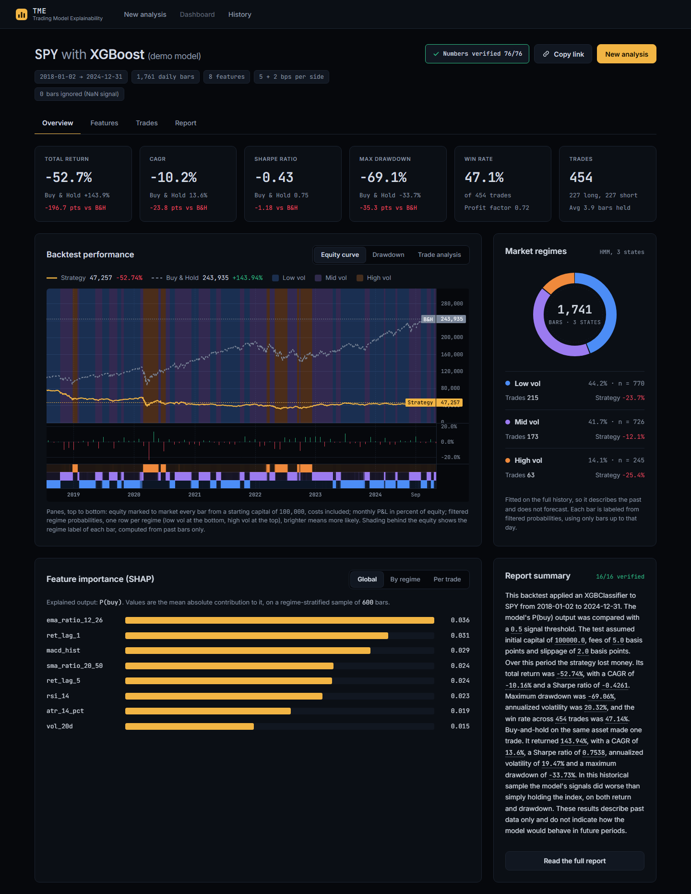
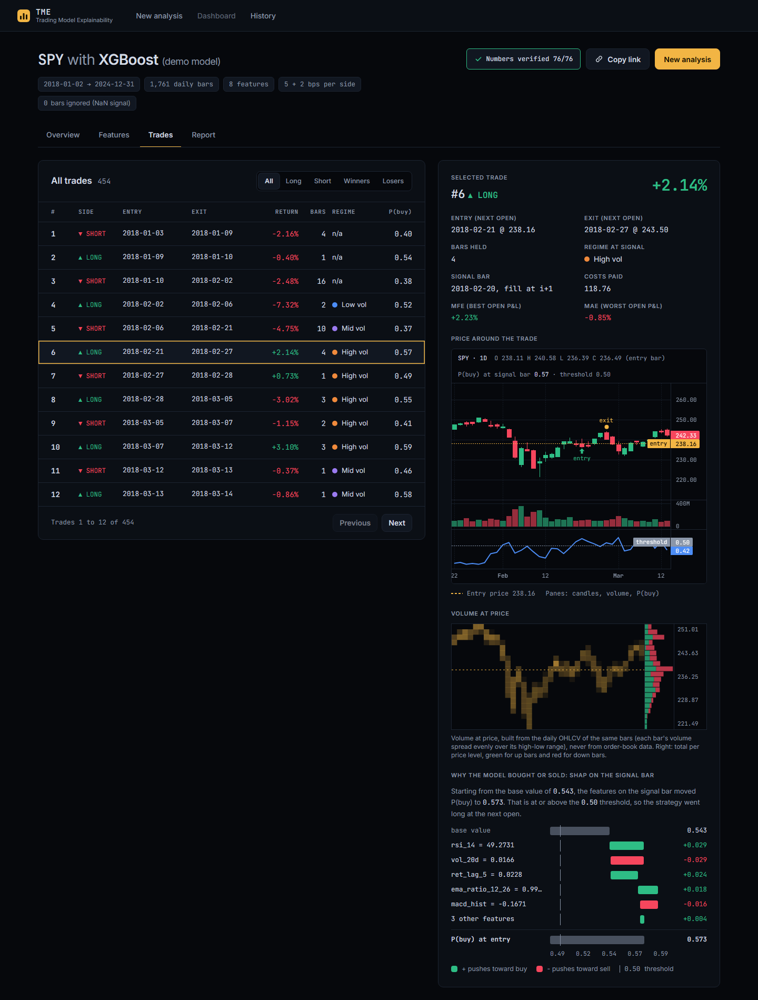
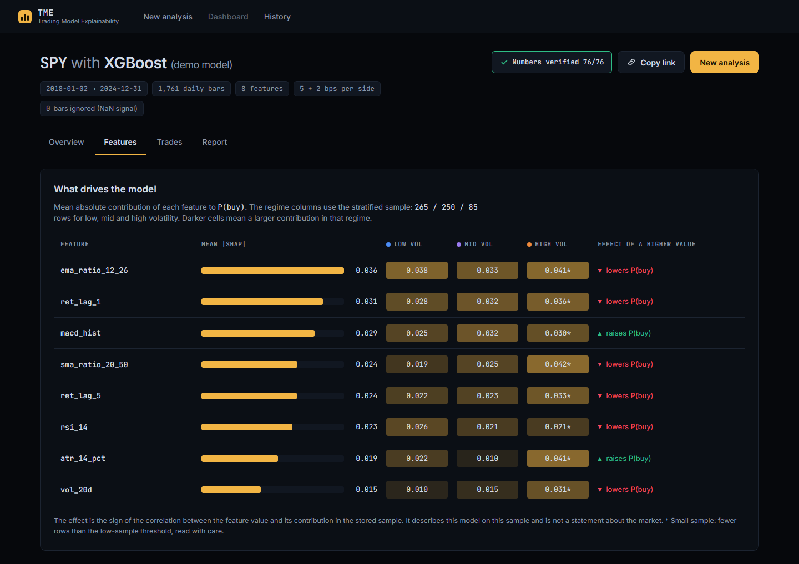

# Trading Model Explainability Tool

Upload a pickled trading model, backtest it on historical prices, and see why it bought or sold on any given day.



## What it does

1. **Data**: daily OHLCV from Yahoo Finance through yfinance, validated against a schema, with features taken from a server-side indicator catalog (RSI, SMA and EMA ratios, MACD, ATR, volatility, lagged returns, volume z-score) or from an uploaded CSV.
2. **Sandboxed prediction**: the model runs in a Docker container with no network, a read-only filesystem, all capabilities dropped and memory and process limits, and produces one signal per bar.
3. **Backtest**: each signal is filled at the next open, fees and slippage are charged on entry and exit, equity is marked to market every bar, and a buy-and-hold benchmark covers the same period.
4. **Regimes and SHAP**: a 3-state Gaussian HMM labels each bar from filtered probabilities, and SHAP explains the model output on a regime-stratified sample and on every trade-entry bar.
5. **Verified report**: Claude writes five fixed report sections from structured JSON, and every number in the text is checked against that JSON.

Four demo models (decision tree, logistic regression, MLP, XGBoost) can be run in one click. Uploaded models can be scikit-learn, XGBoost or LightGBM, saved as `.pkl`, `.pickle` or `.joblib`.

## Explaining a decision

The Trades tab lists every trade. Selecting one shows the candles around it with entry and exit markers, volume, the model output pane with its threshold, a volume-at-price profile built from the same daily bars, and a SHAP waterfall that walks from the base value to the model output on the signal bar.



## Regimes and features

The Features tab ranks features by mean absolute SHAP contribution, overall and per market regime, with the number of sample rows behind each regime and a flag on small samples. A dependence plot shows how each feature value moved the output, coloured by regime.



## Design choices

- **User pickles never load in the API process.** Prediction and SHAP both run in the sandbox, which is designed for the gVisor `runsc` runtime in production; a missing runtime setting fails closed.
- **No lookahead in regimes.** Each bar's regime label comes from forward-only filtered probabilities, so it depends only on bars up to that day. The HMM itself is fitted on the full history, and the UI says so.
- **SHAP explains the probability.** For classifiers it explains P(buy), not the discrete label, and a blocking additivity check rejects explanations whose contributions do not sum to the model output.
- **The LLM only narrates.** Every metric is computed in Python and passed to the model as JSON; numbers in the generated text are verified against that JSON and unverified ones are flagged in the UI.
- **No accounts.** Each analysis is addressed by an unguessable UUID, so the link is the share link; recent analyses are kept in the browser.

## Stack

- **Backend**: Python 3.11, FastAPI, pandas, pandera, scikit-learn, XGBoost, LightGBM, hmmlearn, SHAP, Anthropic SDK, Supabase (Postgres).
- **Frontend**: React 19, Vite, Tailwind CSS 4, lightweight-charts, React Router, Vitest.
- **Sandbox**: Docker, with gVisor `runsc` as the production runtime.

## Run locally

Requirements: Python 3.11, Node.js 20 or later, Docker, a Supabase project and an Anthropic API key.

Create the tables by running the SQL files in `backend/migrations/` in order in the Supabase SQL editor.

Build the sandbox image and start the API:

```bash
cd backend
docker build -t trading-explainability-sandbox -f app/sandbox/Dockerfile.sandbox app/sandbox
python -m venv venv
source venv/bin/activate
pip install -r requirements.txt
cp .env.example .env
uvicorn app.main:app --reload
```

Fill `backend/.env` before starting the server:

| Purpose | Variables |
| --- | --- |
| Required | `SUPABASE_URL`, `SUPABASE_SERVICE_ROLE_KEY`, `ANTHROPIC_API_KEY`, `ENVIRONMENT`, `SANDBOX_DOCKER_RUNTIME` |
| Report | `ANTHROPIC_MODEL`, `REPORT_MAX_TOKENS` |
| Access and abuse limits | `CORS_ORIGINS`, `ALLOW_UPLOAD`, `TRUST_PROXY`, `IP_HASH_SALT`, `RATE_LIMIT_RUNS`, `RATE_LIMIT_WINDOW_SECONDS`, `DAILY_ANALYSIS_CAP` |
| Input caps | `MAX_DATE_RANGE_YEARS`, `MAX_MODEL_FILE_BYTES`, `MAX_FEATURES`, `MAX_CSV_BYTES`, `MAX_CSV_ROWS` |
| SHAP | `SHAP_SAMPLE_SIZE`, `SHAP_MIN_ROWS_PER_REGIME`, `SHAP_LOW_SAMPLE_THRESHOLD`, `SHAP_MAX_TRADE_ROWS`, `SHAP_BACKGROUND_ROWS`, `SHAP_KERNEL_NSAMPLES`, `SHAP_KERNEL_BACKGROUND_SIZE` |
| Jobs and sandbox | `JOB_TIMEOUT_SECONDS`, `MAX_CONCURRENT_JOBS`, `SANDBOX_OUTPUT_CAP_BYTES`, `CONTINUOUS_SIGNAL_DEAD_ZONE`, `PREFLIGHT_ROWS` |

`SANDBOX_DOCKER_RUNTIME` has no default: it accepts `runc` or `runsc`, and must be `runsc` when `ENVIRONMENT` is `production`. The other optional variables fall back to defaults in `backend/app/config.py`.

Start the frontend in a second terminal:

```bash
cd frontend
npm ci
npm run dev
```

The app opens on http://localhost:5173. Set `VITE_API_BASE_URL` in `frontend/.env` if the API is not on http://127.0.0.1:8000.

Tests:

```bash
cd backend
pip install -r requirements-dev.txt
pytest app/tests -q -rs
cd ../frontend
npm run test
```

Backend tests marked `requires_docker` are skipped when the Docker daemon is not reachable.

## Limits and data

- Prices come from Yahoo Finance through yfinance. Downloads are cached in the database; if yfinance is unavailable, bundled daily files for SPY, QQQ and AAPL are used and the dashboard says so.
- Model files up to 10 MB, feature CSVs up to 5 MB, date ranges up to 10 years, up to 30 features, fees and slippage up to 100 bps each. An analysis has a 5-minute time limit.
- TME cannot detect look-ahead in features you upload: a leaky model will look better than it is.

> Educational tool, not investment advice. Backtests use historical data and do not predict future returns. Prices come from Yahoo Finance through yfinance and may be delayed or inaccurate. Market regimes are fitted on the full history to explain behavior, not to forecast it.

## License

MIT
